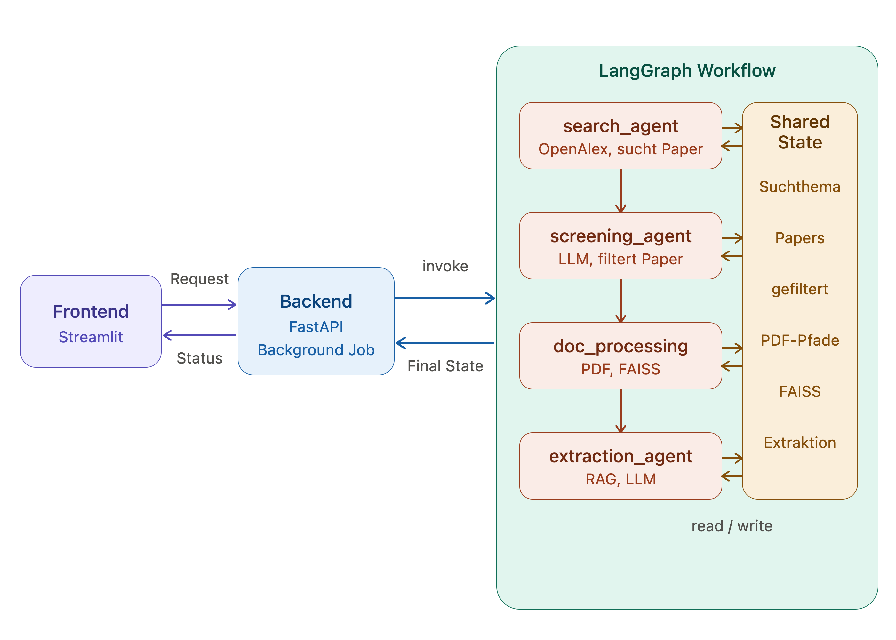
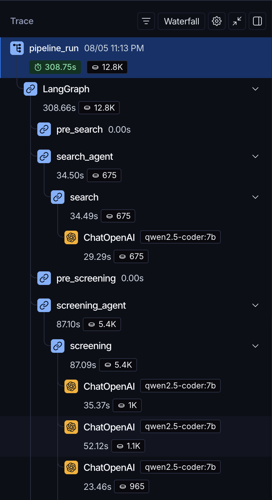
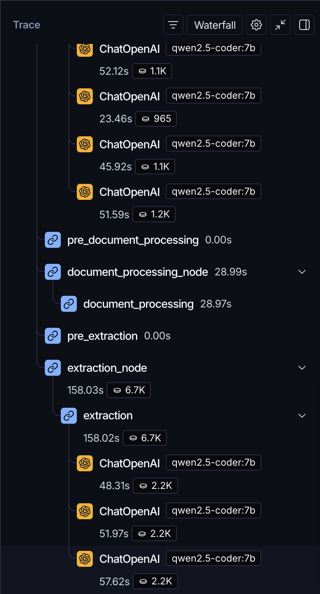

# Multi-Agent Literature Screening System

An automated pipeline for the early stages of a systematic literature review. Given a
research question and inclusion/exclusion criteria, it retrieves candidate papers,
screens them for relevance, downloads the full texts, and extracts structured
information from each included paper.

Built as a Master's team project (Data Science, Hochschule Anhalt) by three students.
All language-model inference runs on self-hosted open-weight models — no external
LLM API is used.

📹 **[Watch the demo (4 min)](https://cloud.hs-anhalt.de/s/49s7N6jTeLAE5BX)** — full
walkthrough of a pipeline run.

---

## The problem

Screening the literature for a systematic review is slow and repetitive. A reviewer
searches an academic database, reads hundreds of titles and abstracts to decide what is
relevant, retrieves the full texts of what survives, and then reads each one to pull out
the same handful of facts — sample size, method, outcome, limitations.

The first three of those steps are mechanical enough to automate, and the fourth is a
structured extraction task that language models handle reasonably well. This system
automates all four as a four-stage agent pipeline.

---

## Architecture



A Streamlit frontend submits a job to the FastAPI backend, which runs the LangGraph
pipeline as a background task and returns a job ID immediately. The frontend polls for
status while the four agents run in sequence, each reading from and writing to a shared
pipeline state.

**Search agent** — expands the research question into a dense synthetic abstract, then
queries OpenAlex semantic search. Filters for open access, publication year, and
citation count.

**Screening agent** — classifies each paper as included, excluded, or uncertain against
the reviewer's criteria. Runs three papers concurrently.

**Document processing** — resolves and downloads each included paper's PDF, extracts and
chunks the text, embeds it with `all-MiniLM-L6-v2`, and retrieves the most relevant
chunks per extraction field via FAISS. Papers whose PDFs cannot be retrieved are flagged
rather than dropped.

**Extraction agent** — produces one structured record per paper from the retrieved
chunks, using RAG over the chunks rather than the full text.

### Why LangGraph

The pipeline currently runs as a linear sequence, which a plain script could also do.
LangGraph was chosen deliberately for where the system is going: conditional routing
(broaden and retry when a search returns nothing, halt and explain when screening
excludes everything), human-in-the-loop review of uncertain papers, and additional agents
slotted into the graph without rewriting the control flow. The orchestration layer is
built for that; the branching logic is the next step.

---

## Infrastructure

Local Ollama inference was too slow to run the pipeline at a usable pace, so inference
was moved to the university's GPU Kubernetes cluster. This let the agents run full
open-weight models without external API costs or rate limits — and made the cluster's
GPU, rather than a laptop, the constraint on throughput.

| | |
|---|---|
| Deployment | `ollama-deployment` (`ollama/ollama:latest`), 1 replica |
| GPU | `nvidia.com/gpu: 1` (requests = limits) |
| Model | `qwen2.5-coder:7b` |
| Service | ClusterIP on port 11434 |

Ollama is tuned for this workload: `OLLAMA_NUM_PARALLEL=4` matches the screening agent's
concurrency, and `OLLAMA_KEEP_ALIVE=24h` keeps the model resident in VRAM so it is not
reloaded on every run.

The application itself is containerised — one image for the FastAPI backend, one for the
Streamlit frontend, wired together with Docker Compose. See
[`deploy/NOTES.md`](deploy/NOTES.md) for full deployment notes.

---

## Performance

The pipeline is instrumented with LangSmith tracing. Every run produces a single trace,
tagged with the job ID from the API, with a span per stage and per LLM call — so a run in
the UI maps directly to a trace with timings and token counts. Tracing is optional: with
the environment variables unset, the pipeline runs unchanged.

<p align="center">
  
  
</p>

Measured on a 5-paper run against `qwen2.5-coder:7b` on the GPU cluster:

| Stage | Time | Tokens |
|---|---|---|
| Search | 34s | 675 |
| Screening | 87s | 5.4K |
| Document processing | 29s | — |
| Extraction | 158s | 6.7K |
| **Total** | **~5 min** | **12.8K** |

**Extraction dominates at 51% of runtime.** Screening makes more LLM calls but finishes
in half the time, because it processes three papers concurrently while extraction runs
strictly sequentially at roughly 50 seconds per paper. Applying the same concurrency to
extraction is the single largest available speedup, and would cut total runtime by around
a third.

This is the kind of finding the tracing was added for — the bottleneck is not where call
volume suggests it should be.

---

## Evaluation

All three stages were evaluated manually, each by the team member who built it, across
3 different research topics.

| Stage | Metric | Result |
|---|---|---|
| Search | Mean precision@10 | > 0.85 |
| Screening | Classification accuracy, consistent across repeated runs | 95% |
| Extraction | Manual review of extracted fields | 90% |

Judgements were made by a single annotator per stage on a small sample, so these are
indications of quality rather than benchmark results. A stronger evaluation would use a
labelled dataset, more topics, and a second annotator with an inter-annotator agreement
statistic.

---

## Getting started

**Prerequisites:** Docker, and access to an Ollama instance running `qwen2.5-coder:7b`.

If Ollama runs on a Kubernetes cluster, open a tunnel to it first:

```bash
kubectl port-forward svc/ollama-service 11434:11434 -n mas-project
```

Then start both services:

```bash
docker compose up
```

The UI is at `http://localhost:8501`.

Running a model locally instead, or connecting to the cluster from scratch, is covered in
[`deploy/NOTES.md`](deploy/NOTES.md).

### Configuration

All settings are read once at startup by `src/llm/settings.py` from the environment and `.env`; the
backend refuses to start if `OPENALEX_EMAIL` is missing.

| Variable | Default | Used by |
|---|---|---|
| `OPENALEX_EMAIL` | required | backend (OpenAlex contact email) |
| `PROFILE` | `local` | backend (`test` swaps in a fake LLM, embedder, OpenAlex and PDFs) |
| `OLLAMA_BASE_URL` | `http://localhost:11434/v1` | backend |
| `SEARCH_MODEL`, `SCREENING_MODEL`, `EXTRACTION_MODEL` | `qwen2.5-coder:7b` | backend (model per role) |
| `EMBEDDING_MODEL` | `sentence-transformers/all-MiniLM-L6-v2` | backend |
| `PDF_DIR` | `pdfs_auto` | backend |
| `DATABASE_URL` | unset | backend (used from the Postgres commits on) |
| `OPENALEX_API_KEY` | unset | backend |
| `LANGSMITH_TRACING` | unset (tracing off) | backend |
| `LANGSMITH_API_KEY`, `LANGSMITH_ENDPOINT`, `LANGSMITH_PROJECT` | unset | backend |
| `BACKEND_URL` | `http://127.0.0.1:8000` | frontend |

Copy `.env.example` to `.env` and fill in the values you need. Inside Compose, the
backend reaches Ollama via `host.docker.internal` (the host end of the port-forward) and
the frontend reaches the backend by service name.

### Running without Docker

```bash
pip install -r requirements.txt
uvicorn src.api.main:app --port 8000
streamlit run src/ui/app.py
```

## Repository layout

```text
src/
  api/        FastAPI app: POST /start_pipeline, GET /status/{job_id}, GET /health
  graph/      LangGraph graph and shared PipelineState
  pipeline/   search/, screening/, ingestion/, extraction/ — the four stages
  llm/        settings, get_llm / get_embedder, tracing, fake test surface, versioned prompts
  ui/         Streamlit frontend
tests/        unit/, e2e/, fixtures/
eval/         frozen v1 search results (eval/snapshots/v1/)
deploy/       Kubernetes/Ollama notes
docs/         plan, designs, backlog
```

Papers flow as dicts through `PipelineState`: `raw_papers` → `screening_results` (four buckets:
`included_papers`, `excluded_papers`, `uncertain_papers`, `failed_papers`) → `extracted_papers`.
Job state is still held in memory, so a backend restart loses running jobs.

## Development

```bash
make test                 # unit + fake end-to-end run; no network, no model download
ruff check src tests
ruff format --check src tests
```

Run everything from the repo root. The reference plan is [`docs/plan_v2.md`](docs/plan_v2.md); the
design for the current phase is [`docs/designs/phase1_foundation.md`](docs/designs/phase1_foundation.md).

---

## Team and contributions

Three-person Master's project.

**Mohamed Elsayed** — LangGraph orchestration layer, FastAPI backend, Streamlit frontend,
search agent, Kubernetes deployment of the LLM inference service, containerisation, and
tracing.

**Jamila Gränzer** — screening agent: per-paper relevance classification against inclusion
and exclusion criteria, with retry handling and structured error reporting.

**Ferass Alrwashdh** — extraction agent: RAG-based structured extraction of predefined
fields from the retrieved document chunks.

---

## Current state and roadmap

The system is a working prototype: the full pipeline runs end to end, on real data, with
self-hosted inference. These are the planned next steps.

**Parallel extraction.** The performance measurement above makes this the clearest
priority — running extraction with the same concurrency as screening would cut roughly a
third off total runtime.

**Conditional routing.** Branching on empty search results and all-excluded screening
passes, plus a broaden-and-retry loop, is what the LangGraph orchestration layer was built
to support.

**Human-in-the-loop review.** Pausing the graph on uncertain screening decisions for
reviewer input, then resuming — a natural fit for a systematic review workflow.

---

## Stack

Python · LangGraph · FastAPI · Streamlit · Ollama · Kubernetes · Docker · LangSmith ·
OpenAlex API · FAISS · sentence-transformers · PyMuPDF
